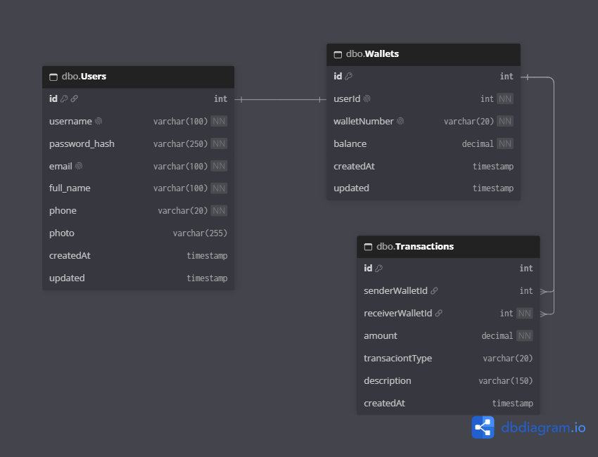
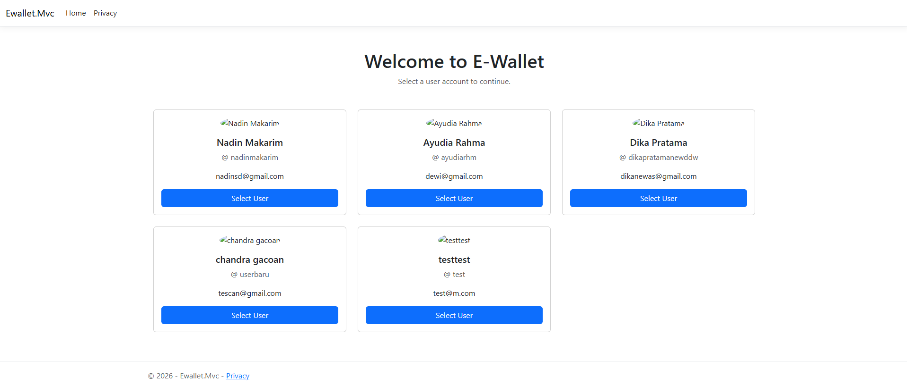
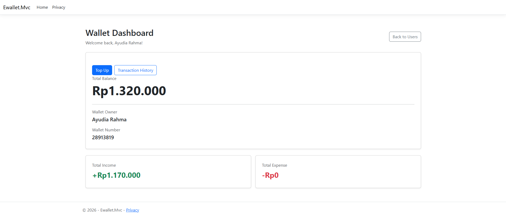
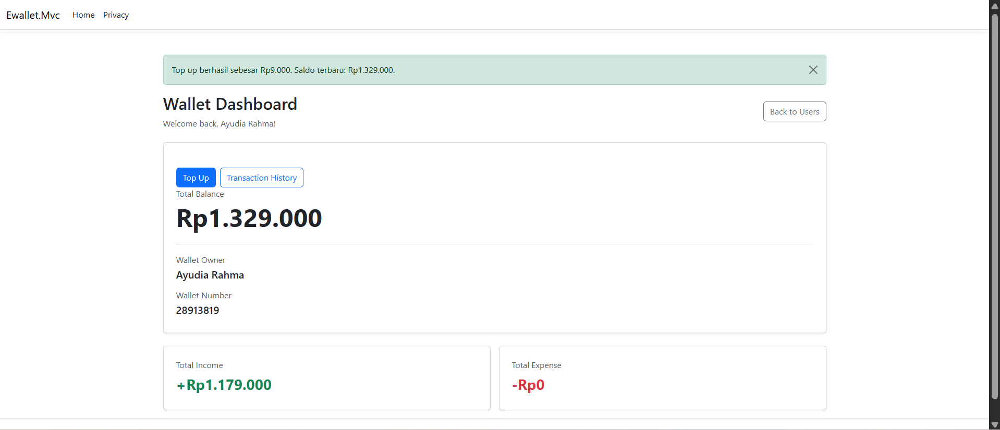
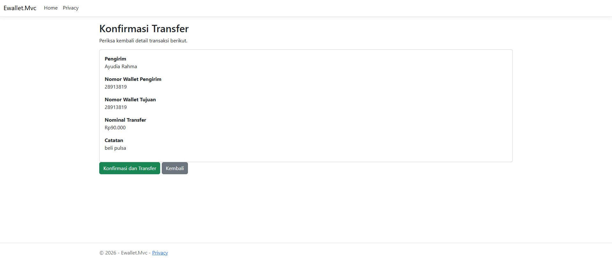
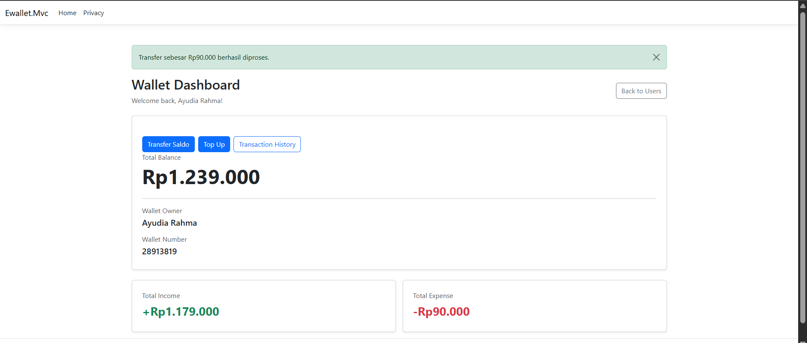
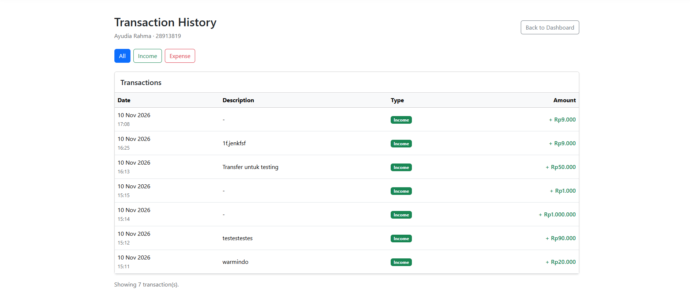

# E-Wallet Application

Aplikasi simulasi E-Wallet berbasis ASP.NET Core .NET 10 yang menyediakan fitur pengelolaan pengguna, wallet, top up saldo, transfer antar-wallet, dan riwayat transaksi.

## Features

- User Management
- Wallet Dashboard
- Top Up Balance
- Wallet-to-Wallet Transfer
- Transaction History
- Transaction Filtering

## Technology Stack

- C# / .NET 10 : Backend development
- ASP.NET Core Web API : REST API
- ASP.NET Core MVC : Web application
- Razor View : Server-side rendering
- SQL Server : Relational database
- ADO.NET : Database access
- Swagger / OpenAPI : API documentation and testing

## Project Structure

```text
Ewallet.Mvc/
├── Controllers/
├── Data/
├── DTOs/
├── Models/
├── Repositories/
├── Services/
├── ViewModels/
├── Views/
├── wwwroot/
├── Program.cs
├── appsettings.json
└── Ewallet.Mvc.csproj
```

### Folder Responsibilities

| Folder       | Responsibility                        |
| ------------ | ------------------------------------- |
| Controllers  | Handle HTTP requests and responses    |
| DTOs         | Define request and response data      |
| Models       | Represent application domain entities |
| Repositories | Handle database operations            |
| Services     | Handle business logic                 |
| ViewModels   | Prepare data for Razor Views          |
| Views        | Render the web interface              |

### Entity Relationship Diagram



## Application Architecture & Flow

### Web API Flow

1. API Client / Swagger
2. masuk ke API Controller
3. masuk ke Service
4. masuk ke Repository
5. akses data Repository ke SQL Server menggunakan ADO.NET (raw SQL)

### MVC / Razor Flow

1. dari user browser
2. masuk ke MVC Controller
3. masuk ke Service yg sama oleh API
4. masuk ke Repository yg akan akses database menggunakan query SQL
5. masuk ke SQL Server
6. menampun data di viewmodel
7. akan diproses dan dipersiapkan ditampilkan di razor view
8. ditampilkan di Browser

## API Endpoints

Base URL: `/api/v1`

| Endpoint Path                     | HTTP Method | Description                        | Available |
| --------------------------------- | ----------- | ---------------------------------- | --------- |
| `/api/v1/users`                   | GET         | Get all users                      | ✅        |
| `/api/v1/users/{id}`              | GET         | Get user detail by ID              | ✅        |
| `/api/v1/users`                   | POST        | Create user and initialize wallet  | ✅        |
| `/api/v1/users/{id}`              | PUT         | Update user profile                | ✅        |
| `/api/v1/wallets/{userId}`        | GET         | Get wallet information by User ID  | ✅        |
| `/api/v1/wallets/{userId}/topups` | POST        | Top up wallet balance              | ✅        |
| `/api/v1/transfers`               | POST        | Transfer balance to another wallet | ✅        |
| `/api/v1/users/{id}/transactions` | GET         | Get user transaction history       | ✅        |

## 7. Getting Started

### Prerequisites

- .NET 10 SDK
- SQL Server
- Visual Studio Code or Visual Studio
- REST Client extension or Swagger UI (optional)

### Clone Repository

```bash
git clone https://github.com/bando9/koda-b1-weekly5
cd Ewallet.Mvc
```

### Database Configuration

Configure the SQL Server connection string in `appsettings.json` or user secrets.

```json
{
  "ConnectionStrings": {
    "Ewalletdb": "Server=YOUR_SERVER;Database=EwalletDb;Trusted_Connection=True;TrustServerCertificate=True;"
  }
}
```

### Create Database

Execute the SQL scripts to create:

- Users
- Wallets
- Transactions

Insert at least three users for testing.

### Run Application

```bash
dotnet restore
dotnet build
dotnet run
```

## Application Screenshots

### User Selection



### Wallet Dashboard



### Top Up



### Transfer




### Transaction History


